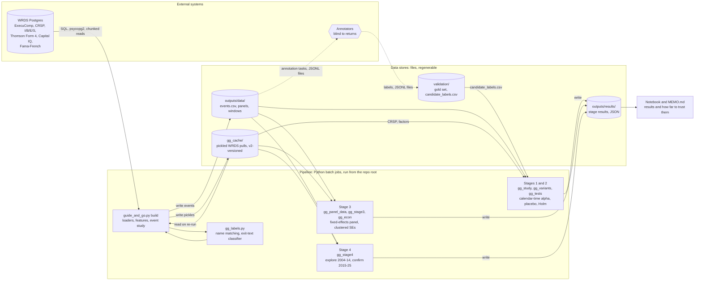
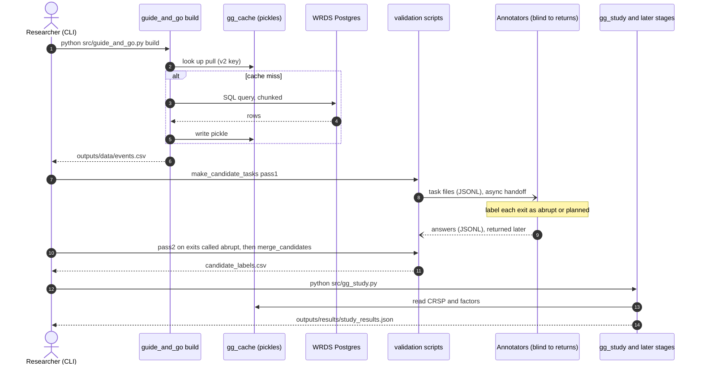

# Guidance Reversal: do executives who guide, sell and leave leave behind a company that underperforms?

**Short answer: no evidence of it.** The pre-registered test finds a risk-adjusted return of **-0.6% a year (t = -0.11, placebo p = 0.39)** for the 42 flagged firms,
and every secondary, stayer-controlled and exploratory test is also null. It is a credible null, not a proof of absence: with 42 events the test could reliably
detect an alpha of about -20% a year, but not -5% to -10%. Full results and how far to trust them: [`MEMO.md`](MEMO.md).

**The idea tested.** A CEO/CFO issues EPS guidance, sells stock after it, then leaves abruptly before the guidance comes due; the firm then underperforms.
We call a firm where all three hold a *Guidance Reversal*. Universe: S&P 1500 CEO/CFO departures announced 2004-2025 (WRDS: ExecuComp, CRSP, I/B/E/S, Thomson Form 4, Capital IQ).

## Requirements: dependencies and credentials (read first)

You can run the unit tests with no accounts. **Rebuilding the data and results needs paid WRDS data access.**

| Need | What | Where it is used |
|---|---|---|
| **WRDS account** (Wharton Research Data Services) | Subscriptions to **ExecuComp** (`comp_execucomp`), **CRSP** (daily stock file, delisting, names), **I/B/E/S** (guidance and actuals), **Thomson Reuters insider filings** (Form 4, schema `tfn`), **Capital IQ** key developments, and the **Fama-French factors** | All pulls in `src/guide_and_go.py` and `src/gg_tests.py` |
| **WRDS credentials** in a `.env` file at the repo root | `WRDS_USERNAME` and `WRDS_PASSWORD` for the **Postgres** connection (preferred), or `WRDS_API_KEY` for the REST API | Never commit `.env`. The REST API **silently truncates large pulls**, so use Postgres for the real run |
| **Python 3.11** (3.11 to 3.12) and [`uv`](https://docs.astral.sh/uv/) | Locked environment in `pyproject.toml` and `uv.lock` | `scripts/setup_env.sh` or `scripts/setup_env.ps1` |
| **Core libraries** | `numpy`, `pandas`, `scipy`, `statsmodels`, `patsy`, `scikit-learn`, `matplotlib`, `requests`, `sqlalchemy`, `psycopg2-binary`, `python-dotenv` | Installed by the setup script |
| Optional: notebook | `nbformat`, `nbconvert`, `ipykernel` | Regenerate and run `notebooks/guide_and_go_analysis.ipynb` |
| Optional: legacy search | `sentence-transformers`, `anthropic` | Only the old semantic-search layer; **not used for any result** |
| **Annotators** (people or models, blind to returns) | The abrupt-exit labels for candidate events | The annotation step in the pipeline; the annotator files are not in this repository, so you need your own annotation pass to reproduce the flag |

No other API key is needed for the results in this repository. The WRDS data is licensed and cannot be redistributed (see the note below the file reference).

## How the project is built, at a glance

Legend: solid arrow = synchronous call or read; **dashed arrow = asynchronous, offline handoff** (a person or model works on files and returns later); cylinder = data store; hexagon = external actor.
This codebase operates as a batch pipeline: WRDS is the only external API, the data stores are files, and the only asynchronous part is the annotation loop.



One end-to-end run, with the synchronous database calls and the asynchronous annotation loop:




| Stage | Question | Method | Verdict |
|---|---|---|---|
| 1 | Do flagged firms underperform? (42 events, pre-specified) | Calendar-time portfolio, 4-factor alpha, placebo-portfolio p-value, Holm over 8 secondary tests | Null |
| 2 | Same, with abruptness dropped and intent proxied by optimistic guidance | Wider links (L1-L4), optimism split, Holm over 14 tests | Null (one borderline test, not treated as a finding) |
| 3 | Do guide-sell-leave firms differ from guide-sell-**stay** firms? | CEO-quarter panel, firm and year-quarter fixed effects, two-way clustered SEs, null-calibrated | Null on P1, P2, P3 |
| 4 | Is there anything in the pattern at all? | Exploration on 2004-2014, selection rule fixed, confirmation on 2015-2025 | Nothing robust; CEO exits not preceded by a sale follow earnings misses |

## Repository map

```
README.md                  you are here
MEMO.md                    results and how far to trust them   <- start here for findings
docs/
  PREREGISTRATION.md       the test, written before the final returns were computed, with disclosures
  STAGE3_SPEC.md           Stage 3 design (stayers as controls, hazard and earnings-miss regressions)
  limitations.md           what was fixed, what is still open, future work
src/                       all Python (flat; run scripts from the repo root)
  guide_and_go.py          WRDS data layer, departures, CRSP/IBES/Form 4/CIQ loaders, features, event study (`build`); legacy RAG + analysis code
  gg_labels.py             name parsing, insider-name matching, departure-text classifier
  gg_tests.py              calendar-time portfolio, factor alpha, placebo test, Holm correction
  gg_study.py              Stage 1: the pre-specified primary + secondary tests
  gg_variants.py           Stage 2: wider links, optimism split
  gg_panel_data.py         Stage 3 data layer: CEO episodes, matched sales, guidance panel, CEO-quarter panel
  gg_econ.py               fixed-effects OLS with clustered SEs, cluster logit
  gg_stage3.py             Stage 3 tests P1-P3 + robustness   (--dry-run randomises outcomes)
  gg_stage3_calibrate.py   null calibration of the Stage 3 regressions
  gg_stage4.py             Stage 4: explore / confirm / explore3b / profile
tests/
  test_gg.py               unit tests + simulations (planted-effect recovery, false-positive rate, power)
notebooks/
  guide_and_go_analysis.ipynb   results notebook (generated)
  make_nb.py                    regenerates the notebook
validation/                hand-labelled evidence that the measurement works
  gold_labels.csv, gold_key.csv       280 hand-labelled departure texts (gold set)
  tasks/, labels_raw/                 blind annotation tasks and the annotators' raw answers
  cand_tasks/, cand_labels_raw/       two-pass reads of every flagged candidate event
  candidate_labels.csv                merged labels consumed by src/gg_study.py
  make_*.py, merge_candidates.py, build_gold.py, evaluate.py   build the sets and score the classifier
gg_cache/                  raw WRDS pulls (several GB; regenerable, versioned `*_v2*`; not source)
outputs/                   everything the code writes (regenerable)
  data/                    events.csv, screen.csv, panel_*.pkl, study_windows.pkl, car_paths.pkl   (inputs to the tests)
  results/                 stage*_results.json, study_results.json, report.md, car_paths.png        (feed the memo and notebook)
  rag/                     legacy semantic-search index (`guide_and_go.py search`)
  logs/                    run logs
pyproject.toml, uv.lock    the environment: dependencies and exact locked versions (Python 3.11)
scripts/setup_env.sh|.ps1  one-command environment setup with uv
.env                       WRDS credentials (never commit or share)
```

**Not in the public repository:** `.env`, `gg_cache/`, `outputs/data/`, `outputs/rag/`, `outputs/logs/` and the `validation/` data files. They hold licensed WRDS data
(CRSP, ExecuComp, I/B/E/S, Thomson Reuters, Capital IQ announcement text) or per-event material about named executives, so they cannot be redistributed. `outputs/results/*.json`
(aggregate statistics only) and the notebook (saved outputs stripped) are included. To reproduce, you need your own WRDS access; the commands below rebuild everything.

## Reproduce

### Setup (one command, using [uv](https://docs.astral.sh/uv/))

```
# once: install uv       winget install --id=astral-sh.uv -e   |   brew install uv   |   pipx install uv
git clone https://github.com/Nayrbnat/guidance-reversal && cd guidance-reversal
scripts/setup_env.sh                  # macOS / Linux / Git Bash.   Windows PowerShell: scripts\setup_env.ps1
uv run python tests/test_gg.py        # sanity check: unit tests + simulations, no data or WRDS access needed
```

This builds `.venv` from the committed `uv.lock`, so everyone gets identical package versions (Python 3.11 is downloaded automatically if you don't have it).
Add `--rag` (`-Rag` on PowerShell) for the legacy semantic-search extras (`sentence-transformers`, `anthropic`). The environment is defined in `pyproject.toml`.

### Run the pipeline

Run everything **from the repo root**, prefixing each command with `uv run` (or activate `.venv`). The pipeline needs your own WRDS access:
put `WRDS_USERNAME` and `WRDS_PASSWORD` in `.env` (Postgres, preferred) or `WRDS_API_KEY`.

```
python src/guide_and_go.py build --start 2004 --end 2025        # data + features (~15 min with a warm gg_cache)
python validation/make_candidate_tasks.py pass1                 # blind annotation tasks for candidate events
#   ... annotate (validation/cand_labels_raw/pass1_*.jsonl), then:
python validation/make_candidate_tasks.py pass2                 # second read of events called abrupt
python validation/merge_candidates.py                           # -> validation/candidate_labels.csv
python src/gg_study.py --start 2004 --end 2025                  # Stage 1 (--dry-run = mechanics check on a RANDOM flag only)
python src/gg_variants.py --start 2004 --end 2025 --reps 5000   # Stage 2
python -u src/gg_panel_data.py feasibility                      # Stage 3 panels (counts only)
python -u src/gg_stage3.py --dry-run --reps 300                 # mechanics with RANDOMISED outcomes
python -u src/gg_stage3.py --reps 5000                          # Stage 3 registered run
python -u src/gg_stage4.py explore                              # Stage 4 (then: confirm / explore3b / profile)
python notebooks/make_nb.py                                     # regenerate the notebook, then execute it
python tests/test_gg.py                                         # unit tests and simulations
python validation/evaluate.py test                              # classifier vs hand labels (held-out half)
```

## Read this before trusting or extending it

* **Do not tune the flag definition after seeing returns.** The registered test is in [`docs/PREREGISTRATION.md`](docs/PREREGISTRATION.md).
* The WRDS **REST API silently truncates large pulls**; the pipeline prefers Postgres and versions its caches. Any cache file without `v2` in its name is a truncated, obsolete pull.
* Annotators for the validation set were language models reading announcement text, blind to returns. A human spot-check is still recommended (see `docs/limitations.md`).
* `guide_and_go.py` also contains legacy analysis and RAG code that predates the rebuild; it is not used for inference.
* The registered documents (`docs/PREREGISTRATION.md`, `docs/STAGE3_SPEC.md`, `MEMO.md`) are historical records and were **not edited** during the reorganisation. Their file
  references predate it: `gg_output/…` is now `outputs/data/`, `outputs/results/` or `outputs/rag/`, and the Python modules and test file now live in `src/` and `tests/`.
